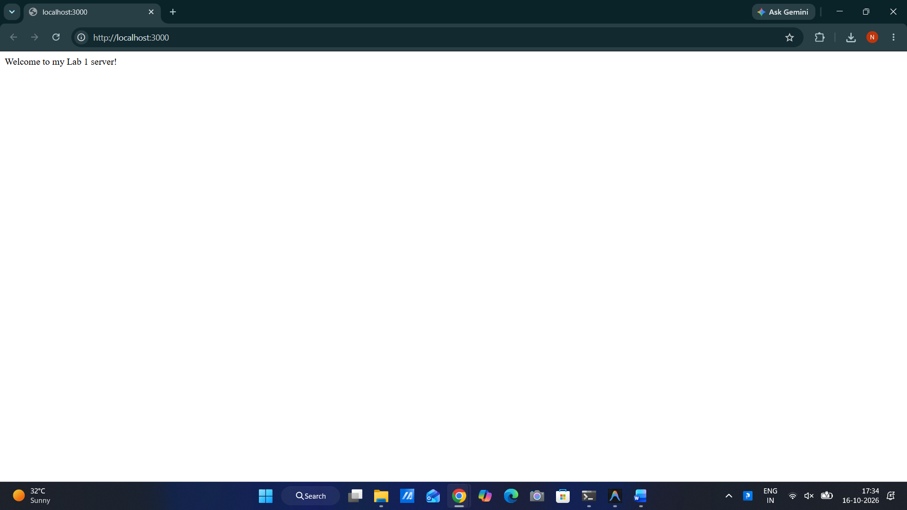
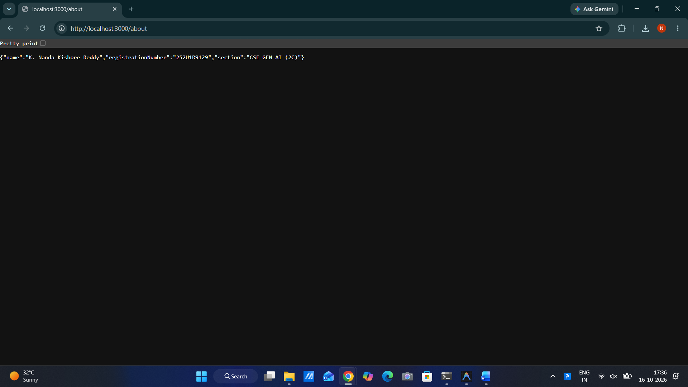
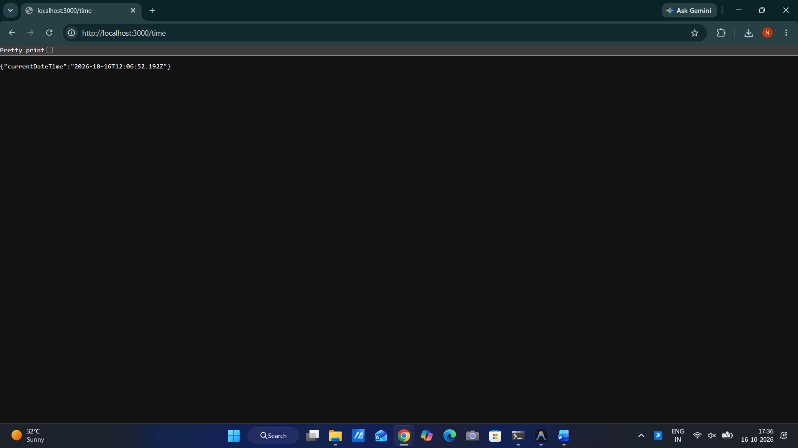
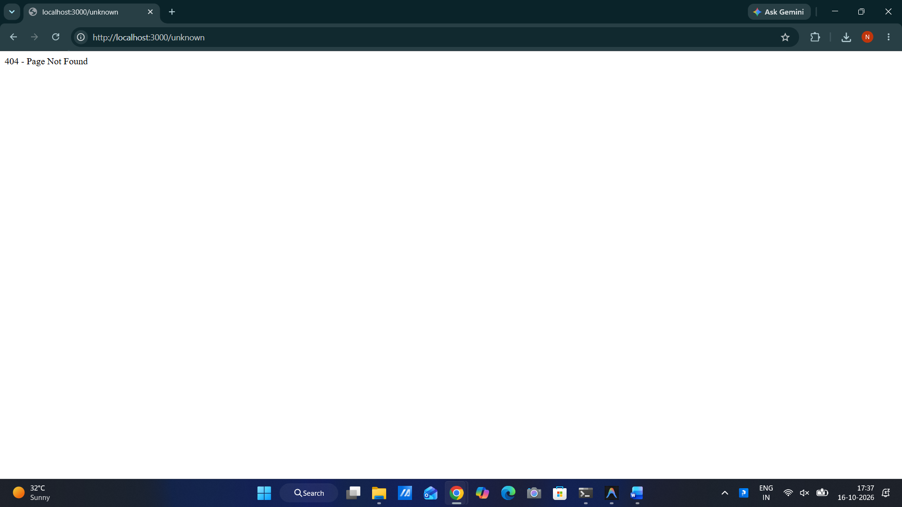

# Lab 1: Node.js and Express Server

## Student Details

- **Student Name:** K. Nanda Kishore Reddy Kalluri
- **Registration Number:** 252U1R9129
- **Section:** CSE GEN AI (2C)
- **Course:** Backend Development Fundamentals
- **Lab Title:** Lab 1: Node.js and Express Server
- **GitHub Repository:** [https://github.com/nandu-reddy-kalluri/Backend_Development_Fundamentals_Lab_01](https://github.com/nandu-reddy-kalluri/Backend_Development_Fundamentals_Lab_01)

---

## Live Link

- **Deployment URL:** Not applicable (local development environment)

---

## Objective

To set up a Node.js project, understand `package.json` configuration, create a basic HTTP server using Node.js's built-in `http` module, and build a modular Express.js web server with distinct routes, dynamic responses, JSON formatting, and appropriate HTTP status codes.

---

## Technologies Used

- **Node.js** (v24.x) - JavaScript runtime environment
- **Express.js** (v5.x) - Fast, minimalist web framework for Node.js
- **JavaScript (CommonJS)** - Core programming language
- **npm** - Node package manager
- **Git & GitHub** - Version control and repository hosting

---

## Project Structure

```text
Backend_Development_Fundamentals_Lab_01/
├── screenshots/
│   ├── home.png
│   ├── about.png
│   ├── time.png
│   ├── not-found.png
│   └── page-not-f.png
├── .gitignore
├── package.json
├── package-lock.json
├── README.md
├── server-http.js
└── server.js
```

---

## Prerequisites

- Node.js (version 18 or above recommended)
- npm (Node Package Manager)
- A modern web browser or API testing tool (e.g., Postman, curl, or Edge/Chrome)
- Git installed on your system

---

## Installation Instructions

1. Clone the repository:

   ```bash
   git clone https://github.com/nandu-reddy-kalluri/Backend_Development_Fundamentals_Lab_01.git
   ```

2. Navigate into the project folder:

   ```bash
   cd Backend_Development_Fundamentals_Lab_01
   ```

3. Install project dependencies:

   ```bash
   npm install
   ```

---

## Running the Servers

> **Important:** Both the plain Node.js HTTP server and the Express server listen on port `3000` by default. Only one server should use port `3000` at a time. Stop the currently running server (`Ctrl + C`) before starting the other.

### 1. Plain Node.js HTTP Server (`server-http.js`)

To run the server implemented with Node.js's built-in `http` module:

```bash
node server-http.js
```

**Output:**
```text
HTTP server running at http://localhost:3000
```
Open [http://localhost:3000](http://localhost:3000) in your browser. The page will display:
```text
Hello
```

### 2. Express Server (`server.js`)

To run the Express web application:

```bash
npm start
```

*(Alternatively: `node server.js`)*

**Output:**
```text
Express server running at http://localhost:3000
```

---

## Endpoint Documentation

| Method | Endpoint | Description | Expected Status |
|---|---|---|---|
| GET | `/` | Welcome message | 200 |
| GET | `/about` | Student information | 200 |
| GET | `/time` | Current date and time | 200 |
| GET | `/unknown` | Not found response | 404 |

---

## Example Requests and Responses

### 1. Home Route (`GET /`)
- **URL:** `http://localhost:3000/`
- **Status Code:** `200 OK`
- **Response (text/html):**
  ```text
  Welcome to my Lab 1 server!
  ```

### 2. About Route (`GET /about`)
- **URL:** `http://localhost:3000/about`
- **Status Code:** `200 OK`
- **Response (application/json):**
  ```json
  {
    "name": "K. Nanda Kishore Reddy",
    "registrationNumber": "252U1R9129",
    "section": "CSE GEN AI (2C)"
  }
  ```

### 3. Time Route (`GET /time`)
- **URL:** `http://localhost:3000/time`
- **Status Code:** `200 OK`
- **Response (application/json):**
  ```json
  {
    "currentDateTime": "2026-10-16T12:14:08.632Z"
  }
  ```
  *(Timestamp is dynamically generated on each request using `new Date()`)*

### 4. Unknown Route (`GET /unknown`)
- **URL:** `http://localhost:3000/unknown` (or any undefined route)
- **Status Code:** `404 Not Found`
- **Response (text/html):**
  ```text
  404 - Page Not Found
  ```

---

## HTTP Status Codes

- **200 OK:** Standard response for successful HTTP requests. Returned for `/`, `/about`, and `/time`.
- **404 Not Found:** Indicates that the requested resource or route does not exist. Returned for all undefined routes.

---

## Screenshots

### Home Endpoint (`GET /`)


### About Endpoint (`GET /about`)


### Time Endpoint (`GET /time`)


### 404 Not Found (`GET /unknown`)


---

## Viva Questions & Answers

### 1. What is the difference between `package.json` and `node_modules`?
- **`package.json`:** A lightweight manifest file that contains metadata about the project, scripts (`start`, `test`), authors, and lists dependency package names and versions. It is committed to version control.
- **`node_modules`:** A physical directory on disk containing the actual downloaded code and binaries of all installed packages and their transitive dependencies. It should never be committed to Git due to its large size.

### 2. What does `app.listen()` do?
`app.listen()` binds and listens for connections on the specified host and port (e.g., port `3000`). It starts the underlying Node.js HTTP server and enters the event loop to receive incoming client requests.

### 3. What do `request` and `response` represent?
- **`request` (`req`):** An object representing the incoming HTTP request from the client. It contains request headers, HTTP method, URL path, query parameters, route parameters, and body data.
- **`response` (`res`):** An object used to construct and send the HTTP response back to the client, including the HTTP status code (e.g., `200`, `404`), headers, and the response body (`.send()`, `.json()`).

---

## Problems Faced and Solutions

1. **Port Collision (EADDRINUSE):**
   - *Problem:* Attempting to run `server-http.js` and `server.js` simultaneously resulted in a port conflict on port `3000`.
   - *Solution:* Ensured that one server is terminated (`Ctrl + C`) before starting the other.
2. **Ignoring `node_modules` in Git:**
   - *Problem:* `node_modules` could easily be staged into Git if not explicitly ignored.
   - *Solution:* Created a comprehensive `.gitignore` file including `node_modules/`, `.env`, and OS/log files before staging any changes.

---

## Git and Repository Configuration

- **Remote URL:** `https://github.com/nandu-reddy-kalluri/Backend_Development_Fundamentals_Lab_01.git`
- **Branch:** `main`
- **Clean Git Tracking:** All source files, configuration, screenshots, and documentation are properly version-controlled with `.gitignore` safeguarding credentials and dependencies.
